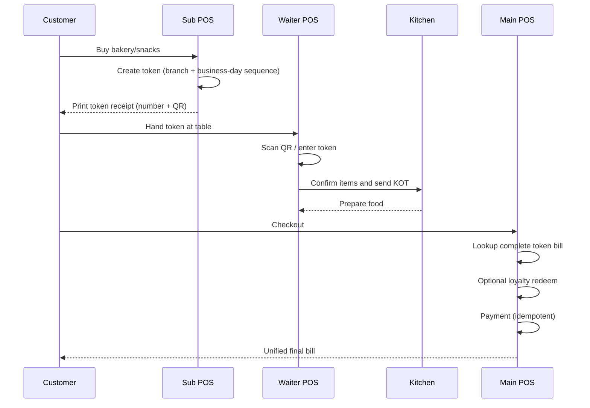
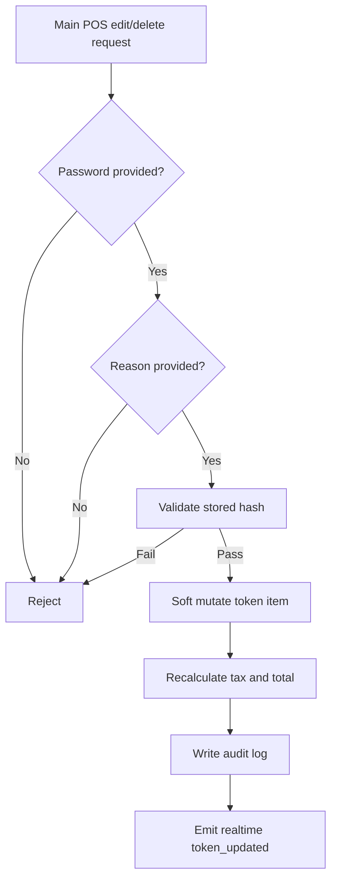

# Enterprise Bakery + Restaurant POS Architecture Plan

## 1. Updated Architecture Plan

### 1.1 System Objective
Transform the current multi-tenant restaurant SaaS into an enterprise bakery + restaurant POS platform with:
- Token-first billing lifecycle
- Branch-scoped operational isolation
- Dedicated role channels (Admin Office, Sub POS, Main POS, Waiter)
- Full auditability, tax correctness, loyalty consistency, and low-latency realtime sync

### 1.2 Organization Model
- Tenant: `Restaurant`
- Child operational unit: `Branch`
- Branch runtime endpoints:
  - `SubPOSTerminal` (token generator)
  - `MainPOSTerminal` (settlement and payment)
  - Waiter POS session (table service + KOT)
- Central office scope:
  - Global policy, branch monitoring, finance, stock, supplier, and analytics

### 1.3 Role Isolation and Permissions
- Admin (Office): Full access across branches and modules
- Sub POS:
  - Allowed: create token, add token items, attach customer
  - Forbidden: edit/delete token items
- Main POS:
  - Allowed: lookup token, add items, loyalty claim, payment
  - Restricted actions: delete/edit require password + reason + audit log
- Waiter POS:
  - Allowed: append restaurant food to token-linked flow and trigger KOT
  - Forbidden: mutate already committed historical items

### 1.4 Runtime Architecture
- API: Fastify route domains (`auth`, `restaurant`, `subpos`, `mainpos`, `customer`)
- Persistence: Prisma + MySQL
- Realtime: Socket.IO events for token/order updates and payment states
- Cache: Redis-backed cache utility for high-read terminal queries

### 1.5 Data Boundaries
All transactional entities are tenant-isolated (`restaurantId`).
Branch-sensitive operations are additionally scoped by `branchId`.
Token sequence is branch + business-day aware.

---

## 2. Database Schema Changes (Prisma)

### 2.1 Implemented in this update
1. `BakeryToken.businessDate` added:
   - Type: `DateTime @db.Date`
   - Purpose: deterministic business-day partitioning for token sequence
2. Branch-day uniqueness enforced:
   - `@@unique([restaurantId, branchId, businessDate, tokenNumber])`
3. Payment idempotency support:
   - `BakeryTokenPayment.idempotencyKey String? @db.VarChar(64)`
   - `@@unique([tokenId, idempotencyKey])`

### 2.2 Existing schema strengths retained
- `BakeryToken`, `BakeryTokenItem`, `BakeryTokenEdit`, `BakeryTokenPayment`
- `SubPOSTerminal`, `MainPOSTerminal`
- `AuditLog`, `TokenCounterConfig`
- `LoyaltyProgram`, `LoyaltyTransaction`
- `RefreshToken` persistence
- Inventory + Supplier + Purchase Order models

### 2.3 Migration SQL intent
- Add `businessDate` column and backfill from existing token date
- Add unique composite for branch/day token sequence
- Add idempotency column + unique composite on token payment

---

## 3. Backend API Changes

### 3.1 Implemented in this update
1. Main POS missing endpoint completed:
   - `POST /api/mainpos/token/:qr/items`
2. Business-day token lookup correction:
   - `POST /api/mainpos/token/lookup` now resolves by `businessDate` + `branchId` for manual token number flow
3. Business-day token generation:
   - `POST /api/subpos/token/create`
   - `POST /api/mainpos/token/create`
4. Payment idempotency:
   - `POST /api/mainpos/token/:qr/payment` supports `idempotency-key` header
   - duplicate key returns safe prior result instead of re-charging
5. Audit trail on payment actions:
   - full payment and partial payment actions now write `AuditLog`
6. Redis cache usage activated:
   - `GET /api/subpos/items`
   - `GET /api/subpos/categories`
   - `GET /api/mainpos/items`
   - `GET /api/mainpos/categories`

### 3.2 Existing critical APIs retained
- Sub POS login and token create/add flow
- Main POS login, lookup, merge-order, edit/delete with password + reason
- Loyalty claim and token payment
- Restaurant-side audit and KOT routes

---

## 4. Frontend Changes Required (Execution Blueprint)

### 4.1 Sub POS (`/subpos/terminal`)
- Barcode-first and keyboard-first entry
- Category-filtered item grid by terminal assignment
- Single primary action: Generate Token
- Print-ready compact receipt view:
  - Large token number
  - QR payload
  - Optional customer details

### 4.2 Main POS (`/mainpos/terminal`)
- Token fetch by QR and number
- Source-aware line items (Sub POS vs Waiter additions)
- Restricted edit/delete modal:
  - password input
  - mandatory reason
- Loyalty claim panel:
  - full/partial redemption
  - live payable recalculation

### 4.3 Waiter (`/waiter` and restaurant POS flows)
- Link token quickly
- Add-only behavior for table service
- Confirm -> send KOT -> update linked bill state

### 4.4 Admin (`/admin`)
- Branch-wise terminal provisioning
- Tax policy management:
  - inclusive/exclusive
  - CGST/SGST/IGST
- Loyalty policy management:
  - points earn and redemption rules
- Operations dashboard:
  - branch sales
  - POS performance
  - token throughput
  - stock alerts
  - supplier balances

---

## 5. Flow Diagrams

### 5.1 Token + Restaurant + Billing Lifecycle


### 5.2 Restricted Edit/Delete Control


### 5.3 Tax Computation
```mermaid
flowchart LR
    A[Subtotal - Discount] --> B{Tax Mode}
    B -- Exclusive --> C[GST = Base * Rate / 100]
    B -- Inclusive --> D[Base = Total * 100 / (100 + Rate)]
    C --> E[Split CGST/SGST or IGST]
    D --> E
    E --> F[Persist subtotal, sgst, cgst, igst, total]
```

---

## 6. Step-by-Step Migration Plan

### Phase 1: Schema and Safety
1. Apply Prisma migration for `businessDate` and payment idempotency columns
2. Backfill `businessDate` for historical `BakeryToken`
3. Create/validate new unique indexes in staging first

### Phase 2: API Deployment
1. Deploy updated Main POS and Sub POS routes
2. Enable `idempotency-key` from frontend payment action
3. Validate payment and token idempotency under retry simulation

### Phase 3: Branch Cutover
1. Enable one pilot branch with new token sequencing
2. Validate Sub POS -> Waiter -> Main POS end-to-end flow
3. Validate audit logs for every critical mutation

### Phase 4: Tax and Loyalty Verification
1. Test inclusive/exclusive tax with intra-state and inter-state scenarios
2. Verify loyalty earn/redeem ledger consistency
3. Reconcile totals in report module

### Phase 5: Performance and Realtime
1. Observe cache hit ratio for terminal reads
2. Validate token fetch SLA (<1s) under load
3. Tune DB indexes for token lookup and payment writes

### Phase 6: Multi-Branch Rollout
1. Roll branch-by-branch with dashboard monitoring
2. Train Sub POS, Waiter, and Main POS operators
3. Run post-rollout reconciliation checklist daily for first week

---

## 7. Security and Compliance Checklist
- JWT verification required for protected routes
- Refresh token persisted and revocable
- Main POS sensitive actions protected by password and reason
- Audit log coverage for item edits/deletes and payments
- Terminal channel isolation (`subpos`, `mainpos`, staff)
- Tenant and branch scoping in all business-critical queries
